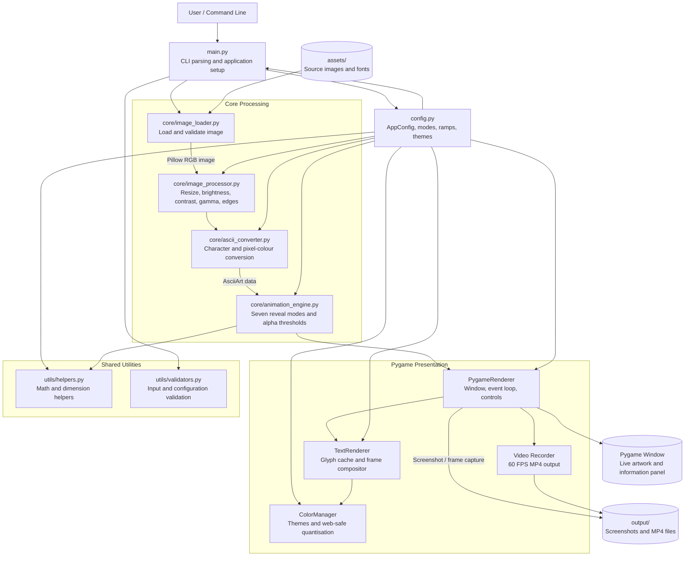
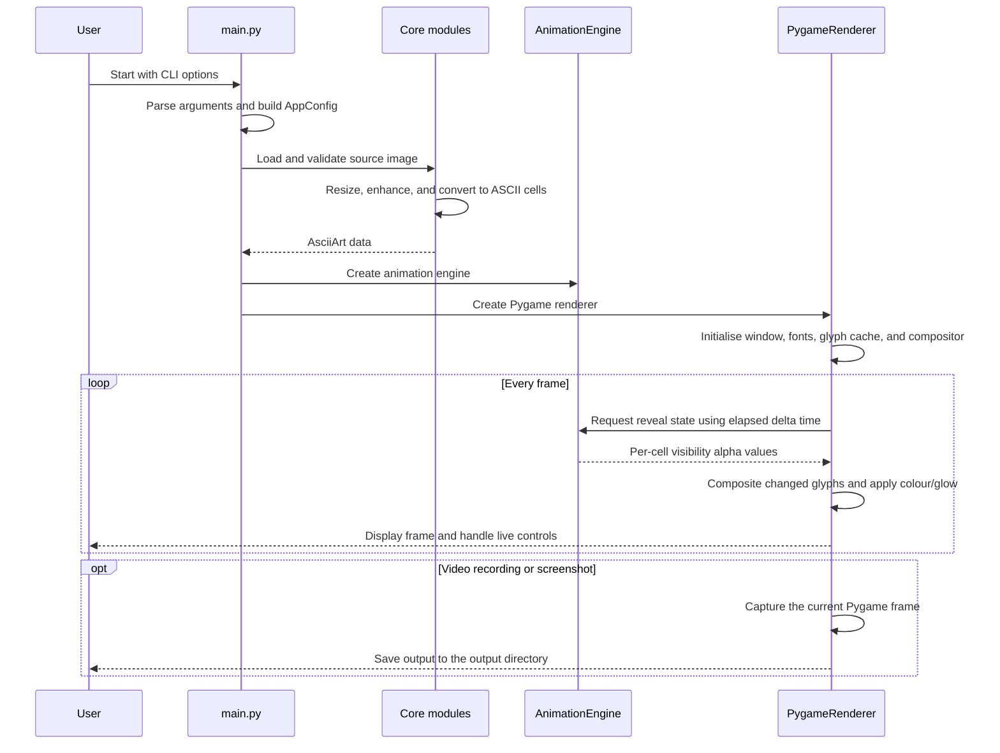

# Architecture Overview

This repository is a modular Python application built around a one-time image conversion pipeline and a Pygame-based delta-time animation/rendering loop.

## Runtime Flow

## Module Responsibilities

- **`main.py`** — Parses CLI arguments, validates configuration, determines output dimensions, loads the image, and wires the core and renderer together.
- **`config.py`** — Defines `AppConfig`, character ramps, animation modes, and monochrome theme presets.
- **`core/image_loader.py`** — Loads and validates supported image formats.
- **`core/image_processor.py`** — Resizes and adjusts image pixels before ASCII conversion.
- **`core/ascii_converter.py`** — Maps brightness values to characters and extracts source colours.
- **`core/animation_engine.py`** — Implements the seven reveal strategies from normalised per-cell thresholds and delta-time progress.
- **`renderer/pygame_renderer.py`** — Owns the Pygame window, event loop, keyboard controls, UI, glow, screenshots, and video capture.
- **`renderer/text_renderer.py`** — Caches glyph surfaces and incrementally composites only cells that change.
- **`renderer/color_manager.py`** — Resolves themes and quantises original colours for efficient glyph caching.
- **`utils/`** — Provides shared numerical helpers and meaningful input/configuration validation.
