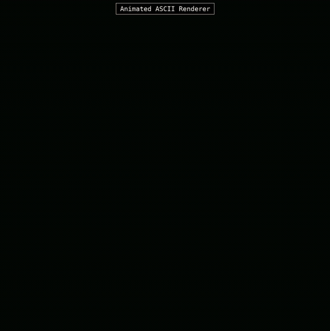
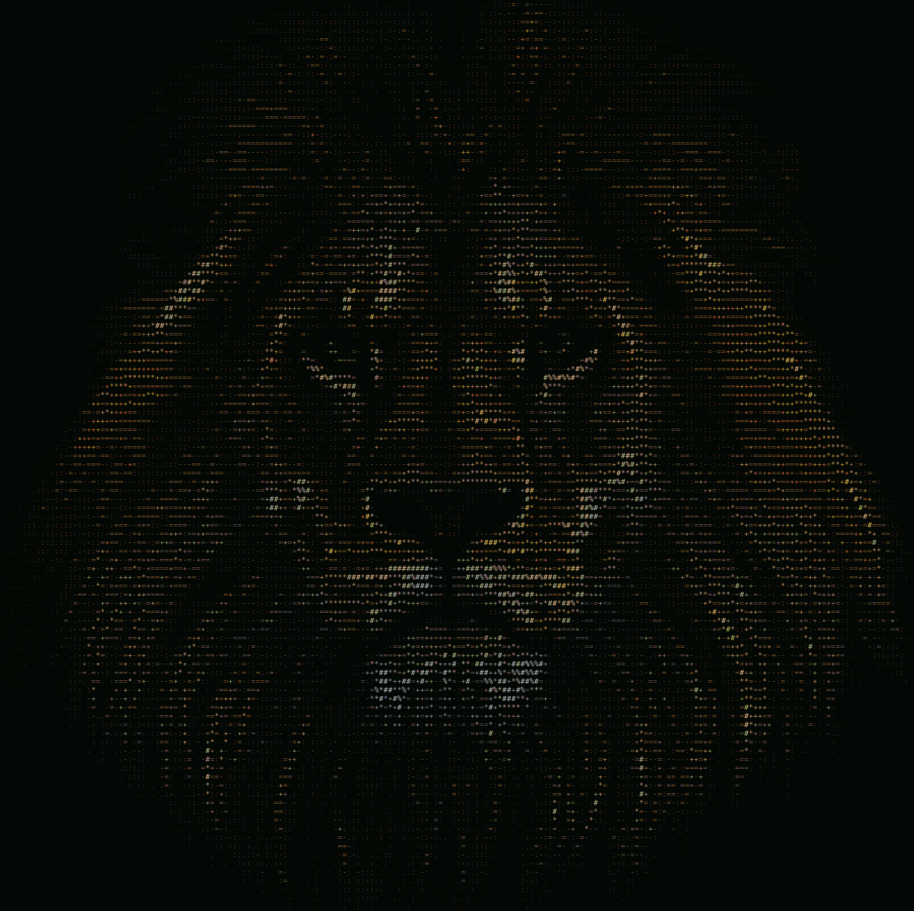

<div align="center">

# Animated ASCII Image Renderer

**Convert any image into detailed ASCII art and reveal it through smooth, animated effects.**

A Python creative-coding project that turns photographs into recognizable ASCII
artwork and develops it on screen with seven distinct animation engines —
progressive sweep, random decode, scan line, center expansion, wave, matrix
decode and fade-in — rendered with Pygame in monochrome phosphor themes or
full original colour, with optional bloom glow and built-in video recording.




</div>

---

## Table of Contents

- [Overview](#overview)
- [Features](#features)
- [Screenshots](#screenshots)
- [Installation](#installation)
- [Quick Start](#quick-start)
- [Usage](#usage)
  - [Command-line options](#command-line-options)
  - [Animation modes](#animation-modes)
  - [Keyboard controls](#keyboard-controls)
  - [Video recording](#video-recording)
- [How It Works](#how-it-works)
- [Performance](#performance)
- [Error Handling](#error-handling)
- [Project Structure](#project-structure)
- [Testing](#testing)
- [License](#license)

## Overview

This is not just an "image to ASCII" converter. The focus is on the **animated
reveal**: a polished, delta-time-based animation engine progressively develops
the artwork on screen, while a high-performance renderer keeps the loop at 60
FPS through glyph caching and incremental frame compositing.

The conversion pipeline (Pillow + NumPy) preserves aspect ratio, compensates for
character-cell proportions, and supports brightness / contrast / gamma,
optional inversion and edge enhancement — so the output reads as a genuine
picture, not random characters.

## Features

- **Robust image input** — PNG / JPG / JPEG / BMP / WEBP, with validation for
  missing files, unsupported formats and corrupted data.
- **High-quality conversion** — perceptual grayscale, aspect-ratio preservation
  with character-cell compensation, configurable ramps, brightness / contrast /
  gamma, optional inversion and edge enhancement.
- **Seven animation modes** — Progressive, Random, Scan, Center, Wave, Matrix
  and Fade-In, all delta-time based with configurable speed and frame rate.
- **Two colour modes** — monochrome (white / green / amber / cyan phosphor
  themes) and original-colour (each character takes its source pixel colour).
- **Polished presentation** — resizable window, centered proportional artwork,
  crisp monospaced rendering, cached glyphs, incremental frame updates, subtle
  bloom glow and a live information panel.
- **Video recording** — capture the animation to a 60 FPS MP4 with a title
  overlay, either interactively (`V`) or scripted from the command line
  (`--record`).
- **Interactive controls** — pause, restart, switch modes live, change speed,
  toggle colour, invert, change theme, toggle glow, save a screenshot.
- **Clean modular architecture** — separate `core`, `renderer` and `utils`
  packages; nothing is recalculated per frame that can be precomputed.

## Screenshots

<div align="center">

| Original-colour render (default) | Monochrome terminal theme |
|---|---|

</div>



*The bundled `assets/example.jpg` (a lion portrait) rendered at 200 columns in
original-colour mode. The same image can be shown in green / amber / cyan /
white monochrome themes by pressing `C` then `T`.*

## Installation

Requires **Python 3.10+**.

```bash
git clone <your-repo-url>
cd animated_ascii
pip install -r requirements.txt
```

This installs:

| Package            | Purpose                                                      |
|--------------------|--------------------------------------------------------------|
| `pygame-ce`        | Window, rendering loop, input, animation (imports as `pygame`) |
| `Pillow`           | Image loading, resizing, edge detection                      |
| `numpy`            | Fast pixel / brightness / threshold math                     |
| `imageio`          | Video recording (MP4 / H.264)                                |
| `imageio-ffmpeg`   | Self-contained ffmpeg binary — no system ffmpeg required     |

> The recording packages are only needed for the `V` key / `--record` feature.
> If they are missing the rest of the application still runs; pressing `V`
> simply shows an install hint.

## Quick Start

```bash
python main.py --image assets/example.jpg
```

Every option has a sensible default, so this is enough to see the full animated
reveal. By default the artwork is rendered in **original colour** (so
photographic subjects are immediately recognisable); press `C` or pass
`--color mono` for the classic phosphor-terminal look.

## Usage

```bash
python main.py --image assets/example.jpg --mode 5 --width 200 --color original
```

### Command-line options

| Option          | Default        | Description                                              |
|-----------------|----------------|----------------------------------------------------------|
| `--image`       | `assets/example.jpg` | Source image path (png/jpg/jpeg/bmp/webp)          |
| `--width`       | `0` (auto)     | ASCII width in characters                                |
| `--height`      | `0` (auto)     | ASCII height in characters                               |
| `--ramp`        | `default`      | `default` / `dense` / `minimal` / `block` or a literal string |
| `--font-path`   | DejaVu Sans Mono | Path to a monospaced TTF/OTF                           |
| `--font-size`   | `16`           | Font size in pixels                                      |
| `--mode`        | `1`            | Animation mode `1`–`7`                                   |
| `--speed`       | `1.0`          | Animation speed multiplier                               |
| `--fps`         | `60`           | Target frames per second                                 |
| `--color`       | `original`     | `mono` or `original` (mono uses the theme foreground)   |
| `--theme`       | `green`        | `white` / `green` / `amber` / `cyan`                     |
| `--fg`          | (theme)        | Override foreground as `r,g,b`                           |
| `--bg`          | (theme)        | Override background as `r,g,b`                           |
| `--brightness`  | `1.0`          | Brightness multiplier (0–4)                              |
| `--contrast`    | `1.0`          | Contrast multiplier (0–4)                                |
| `--gamma`       | `1.0`          | Gamma correction (0.1–4)                                 |
| `--invert`      | off            | Invert the brightness→character mapping                  |
| `--edges`       | off            | Edge-enhance the ASCII output                            |
| `--window`      | auto           | Initial window size `WxH`                                |
| `--no-info`     | off            | Hide the information panel                               |
| `--glow`        | off            | Enable bloom glow                                        |
| `--title`       | (filename)     | Title overlay burned into recorded videos                |
| `--record-fps`  | `60`           | Frame rate for video recording                           |
| `--record`      | off            | Auto-record on launch: `--record` (until finished) or `--record N` (N seconds), then quit |
| `--max-width`   | `320`          | Hard cap on ASCII width                                  |
| `--max-height`  | `200`          | Hard cap on ASCII height                                 |
| `--list-modes`  | —              | Print the animation modes and exit                       |

### Animation modes

| # | Name               | Behaviour                                                   |
|---|--------------------|-------------------------------------------------------------|
| 1 | Progressive Reveal | Diagonal sweep, left→right and top→bottom                   |
| 2 | Random Decode      | Cells appear in a randomised order (digital decode feel)    |
| 3 | Top-to-Bottom Scan | A moving horizontal scan line reveals row by row            |
| 4 | Center Expansion   | Reveals outward from the centre of the image                |
| 5 | Wave Reveal        | A sinusoidal wavefront sweeps across the artwork            |
| 6 | Matrix Decode      | Random characters settle into the correct ones in a band    |
| 7 | Fade-In            | The whole artwork uniformly develops from dark to full      |

### Keyboard controls

| Key       | Action                                            |
|-----------|---------------------------------------------------|
| `SPACE`   | Pause / resume the animation                      |
| `R`       | Restart the current animation                     |
| `1`–`7`   | Switch animation mode                             |
| `+` / `-` | Increase / decrease animation speed               |
| `C`       | Toggle monochrome / original colour               |
| `I`       | Invert the brightness→character mapping           |
| `T`       | Cycle monochrome colour theme                     |
| `G`       | Toggle the bloom glow effect                      |
| `H`       | Hide / show the information panel                 |
| `S`       | Save a screenshot to `output/`                    |
| `V`       | Start / stop video recording (60 FPS MP4)         |
| `ESC`     | Exit the application                              |

The information panel shows the source filename, current mode, progress,
current FPS, ASCII dimensions, colour mode, speed and play/pause state.

### Video recording

Press `V` during playback to start recording the animation to an MP4 video at
**60 FPS** (configurable with `--record-fps`). Each recorded frame has the
**title overlay** burned in at the top — the source filename by default, or any
text you pass with `--title`. A live `REC mm:ss` indicator is shown in the
corner while recording (it is *not* written into the video, which stays clean).

Press `V` again (or `ESC`) to stop; the file is saved to
`output/<title>_<timestamp>.mp4`. The recording is also finalised safely if the
window is closed mid-record.

For **scripted / headless capture**, pass `--record` on the command line: the
app starts recording immediately, writes the video, prints the saved path to
stdout, and quits on its own (no window interaction needed).

```bash
# Record the full reveal (until the animation finishes) and quit
python main.py --image assets/example.jpg --record --title "Lion ASCII"

# Record exactly 4 seconds at 60 FPS
python main.py --image assets/example.jpg --record 4 --record-fps 60

# Scripted: capture the path of the produced video
VIDEO=$(python main.py --image assets/example.jpg --record 5 | \
       sed -n 's/^Saved video: //p')
echo "produced: $VIDEO"
```

> The capture rate is decoupled from the render rate, so the saved video always
> plays back in real time at the requested FPS. Resizing the window is disabled
> while recording (the encoder needs a constant frame size).

## How It Works

### Conversion

1. Pillow loads and validates the image, flattening it to RGB.
2. The image is resized with LANCZOS so each output pixel maps to one ASCII
   cell, with the height compensated for the character-cell aspect ratio.
3. Brightness, contrast and gamma are applied in float space; edges are
   optionally detected with Pillow's Sobel-based `FIND_EDGES` and blended in.
4. Each cell's perceptual luminance selects a character from the ramp.

> **Mapping convention.** The ramp is stored densest-first
> (`@%#*+=-:. `). Because the renderer draws light characters on a dark
> background, *bright* pixels select the **densest** character so that bright
> regions actually look bright (more ink = more light). This produces
> recognisable artwork. Press `I` (or pass `--invert`) to flip to the classic
> "dark pixel → dense character" paper/negative look.

### Animation

Every mode shares one model:

```
alpha(row, col) = clamp((progress - threshold) / window, 0, 1)
```

`threshold` is a per-cell matrix whose shape depends on the mode (diagonal
distance, random permutation, distance from centre, a travelling sine, …).
Thresholds are normalised to `[0, 1 - window]` so the image is guaranteed to be
fully revealed exactly when `progress` reaches 1. This keeps per-frame work to a
handful of NumPy operations.

### Rendering

- The full ASCII conversion runs **once**, before animation starts.
- A `GlyphCache` renders each character once in white, then tints cached copies
  on demand. Original colours are quantised to the 216-colour web-safe palette
  so the cache stays small.
- A `FrameCompositor` keeps a persistent offscreen surface and only re-clears /
  re-blits cells that actually changed since the last frame (incremental diff),
  which makes most reveals nearly free per frame and keeps matrix flicker
  bounded to the active decode band.
- The composited frame is centred in the window and smoothly scaled down if the
  window is smaller than the artwork.

## Performance

- Target is 60 FPS for typical grids (up to ~160×80). Very large grids (near
  the 320×200 cap) remain smooth in the reveal modes; the Fade and Matrix modes
  do more work because more cells change per frame.
- `--glow` adds one extra downscaled blur blit per frame — turn it off for the
  largest grids.
- `--max-width` / `--max-height` protect against accidentally huge outputs.
- Video recording uses a time accumulator so the saved file is always real-time
  at the requested FPS regardless of render speed.

## Error Handling

The program validates inputs and reports clear messages instead of tracebacks
for: missing files, unsupported formats, corrupted images, empty files, invalid
configuration values, and display-initialisation failures. Validation errors
exit with code `2`; unexpected errors exit with code `1`.

```bash
$ python main.py --image nope.png
error: Image file not found: nope.png

$ python main.py --image README.md
error: Unsupported image format '.md'. Supported formats: .png, .jpg, .jpeg, .bmp, .webp.
```

## Project Structure

```text
animated_ascii/
├── main.py                  # CLI entry point: parsing, wiring, error handling
├── config.py                # Centralized AppConfig + ramps / modes / themes
│
├── core/
│   ├── image_loader.py      # Load + validate images with Pillow
│   ├── image_processor.py   # Resize, brightness/contrast/gamma, edges, grayscale
│   ├── ascii_converter.py   # Brightness -> character mapping + colour extraction
│   └── animation_engine.py  # The 7 animation modes (delta-time, threshold based)
│
├── renderer/
│   ├── pygame_renderer.py   # Window, loop, input, info panel, glow, recording
│   ├── text_renderer.py     # Glyph cache + incremental frame compositor
│   └── color_manager.py     # Theme presets + web-safe colour quantisation
│
├── utils/
│   ├── helpers.py           # Clamp / lerp / easing / dimension math
│   └── validators.py        # Input validation with meaningful errors
│
├── assets/
│   ├── example.jpg          # Bundled demo image
│   └── fonts/               # Drop a custom .ttf here (optional)
│
├── docs/
│   ├── demo.gif             # Animated demo
│   └── screenshot.png       # Static render
│
├── output/                  # Screenshots and recorded videos land here
├── requirements.txt
└── README.md
```

## Testing

The conversion and controls were validated against portrait, landscape, square,
high-contrast, dark-background, bright-background and fine-detail images:

- ASCII output resembles the original image (VLM-verified: the bundled lion is
  recognised with eyes, nose, muzzle and mane).
- Aspect ratio is maintained (≤ ~1.4% error across square / landscape / portrait
  / wide crops).
- Every animation mode works and completes.
- Pause / resume, restart and all keyboard controls respond immediately.
- Colour rendering (mono + original) works and toggles live.
- Window resizing keeps the artwork centred and proportional.
- `--record` and the `V` key produce valid 60 FPS MP4 files with the title
  overlay, and quit cleanly.
- Large images stay responsive within the configured caps.

Run a quick sanity check with the bundled image:

```bash
python main.py --image assets/example.jpg --list-modes
python main.py --image assets/example.jpg --record 2 --speed 8
```

## License

Released under the **MIT License**. See the repository for license details.
The bundled `assets/example.jpg` demo image is AI-generated for this project.
